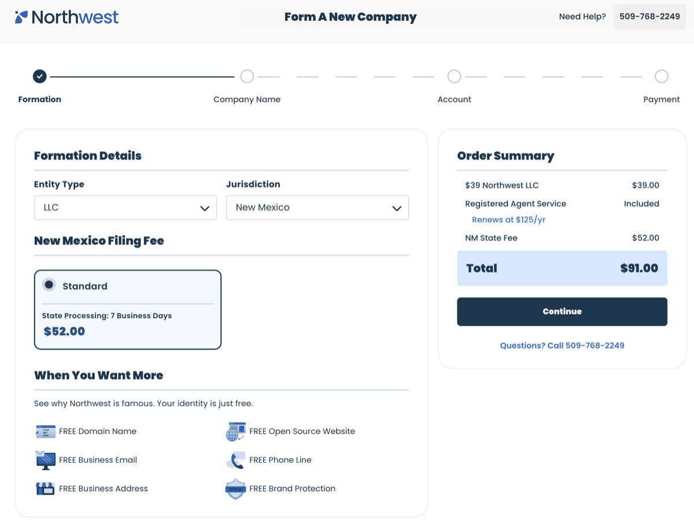
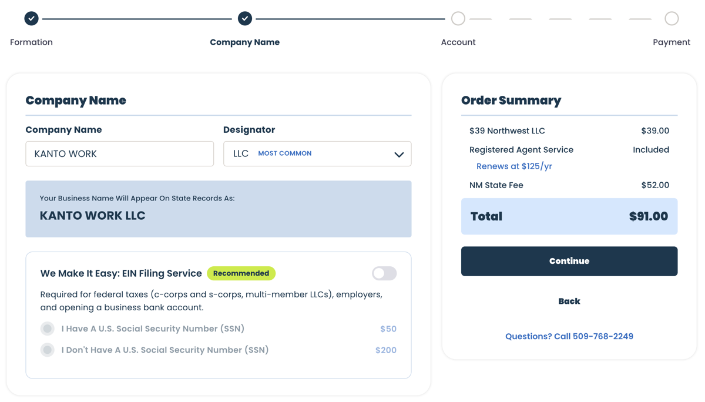
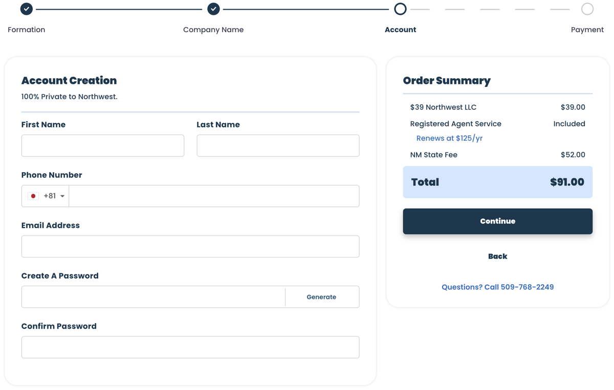
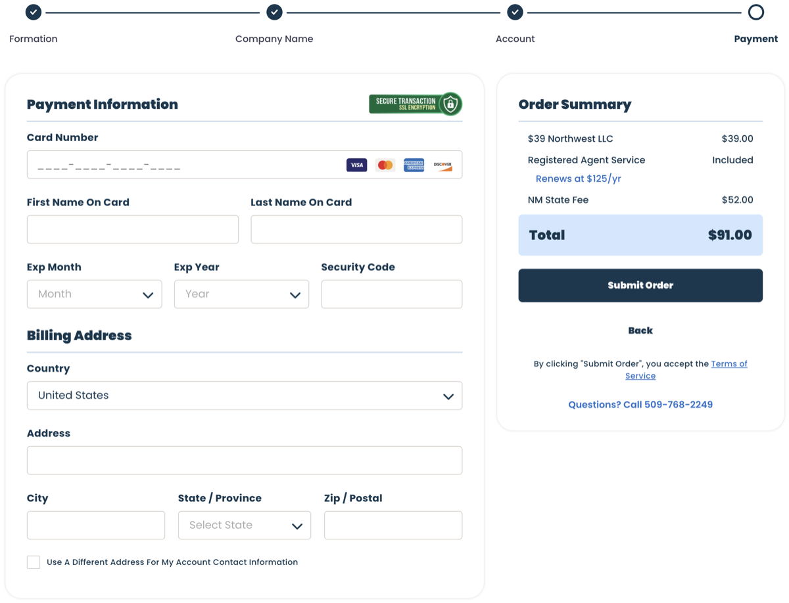
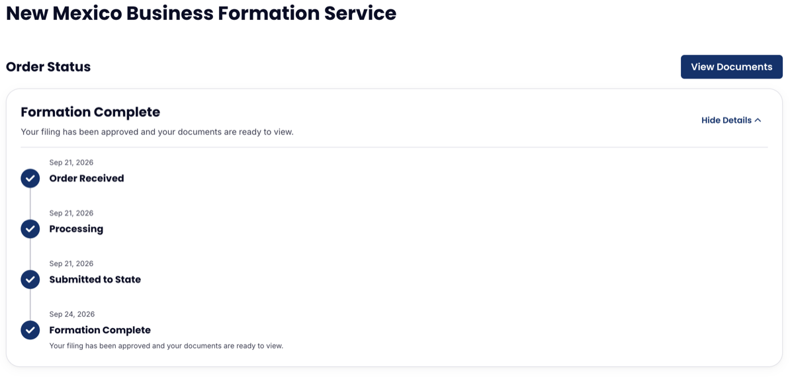

前回の記事に続き、今回は登録エージェントサービス **Northwest Registered Agent** を利用して実際に KANTO WORK LLC を設立した手順と期間をまとめます。

## 登録エージェントサービスを選ぶ

米国で非居住者がLLCを設立・維持するには、州内に住所を持つ「Registered Agent（登録代理人）」が必須です。数あるサービスの中からNorthwestを選んだ理由は以下の点です：

- **プライバシー保護**：エージェントの住所を書類上の所在地として利用できるため、自宅住所を公開せずに済む
- **明朗会計**：余計な有料オプションの抱き合わせが少なく、エージェント費用が年額$125程度と良心的
- **海外居住者によるLLC設立に対応**

### 会社名の決定

ニューメキシコ州の州務長官（Secretary of State）の公式サイトで、希望する会社名がすでに使用されていないか事前に重複チェックを行います。

- [New Mexico Secretary of State - Business Services](https://www.sos.nm.gov/business-services/)

> **注意**: このサイトはセキュリティ制限のため**アメリカ国外からのアクセスが遮断**されています。
> 日本からアクセスする場合は、米国のVPNサーバー経由（[ProtonVPN](https://protonvpn.com/ja) などで米国サーバーを指定）で接続して検索する必要があります。

---

### 設立の手順

#### 1. 基本情報の入力

- **Entity Type**: `LLC` を選択
- **Jurisdiction**: `New Mexico`（ニューメキシコ州）を選択

#### 2. 会社名の入力とオプション選択

- **Company Name**: 設立したい会社名（例: `KANTO WORK`）を入力
- **Designator**: 会社形態の表記（`LLC`, `L.L.C.` など）を選択
- **EIN（連邦雇用主識別番号）の選択**:
  - コストを節約するため、今回は代行オプションなしを選択しました。
  - ※EINは米国での法人口座開設やD-U-N-S Number取得に必須となる米国の納税者番号です。
  - 登録エージェントに取得代行を依頼することも可能ですが、自分自身でIRSへFAX送信して申請すれば費用を節約できます（次回詳しく解説します）。

#### 3. アカウント作成

- Northwestのポータルサイトにログインするためのアカウントを作成します。
- 連絡先メールアドレスやログインパスワード、氏名等を入力します。

#### 4. 決済と申請

- **Payment Information**: クレジットカード情報を入力
- **Billing Address**: 日本のクレジットカード登録住所（領収書住所）を入力
- 内容を確認して決済を済ませれば、オンラインでの申し込み手続きは10分程度で完了します。

#### 5. 設立完了と書類のダウンロード

申請から **4日間** で無事に州政府への登録と法人の設立が完了しました！
登録完了の連絡はメールで届き、Northwestのダッシュボード（Documents）から以下の重要書類がダウンロードできるようになります：

- **Formation Document**
  - NOTICE OF FILING APPROVAL (1ページ目: 承認通知)
  - ARTICLES OF ORGANIZATION (2-3ページ目: 組織定款)
  - STATEMENT OF ACCEPTANCE OF APPOINTMENT AS REGISTERED AGENT
  - CERTIFICATE OF ORGANIZATION (5ページ目: 設立証明書)
- **OPERATING AGREEMENT**（運営規約）
- **INITIAL RESOLUTIONS**（初回決議書）

これらは今後の法人口座開設やD-U-N-S Number取得、Apple Developer申請などで提出を求められる正式な証明書となりますので、大切に保存しておきます。

次回は、費用を抑えるために自分で行った **「IRSへのEINの取得申請手順」** について紹介します。
