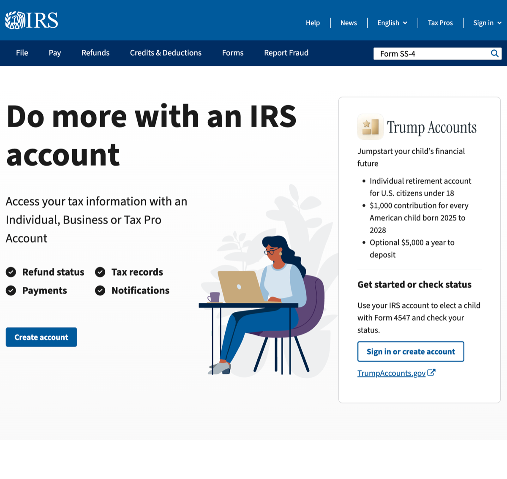
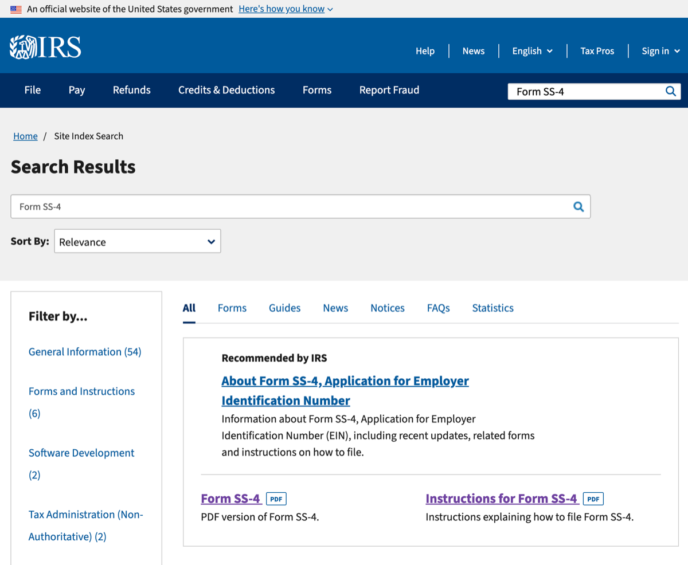
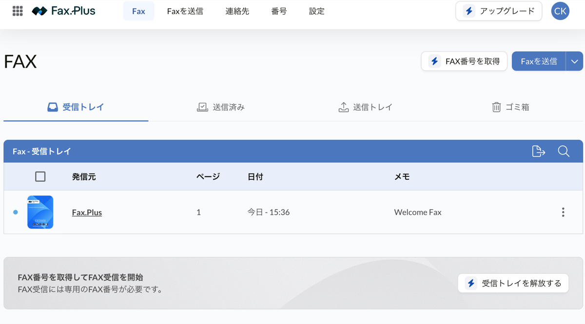
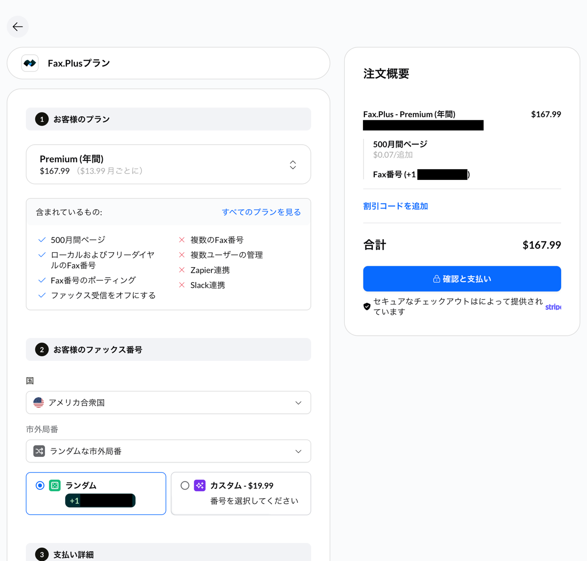
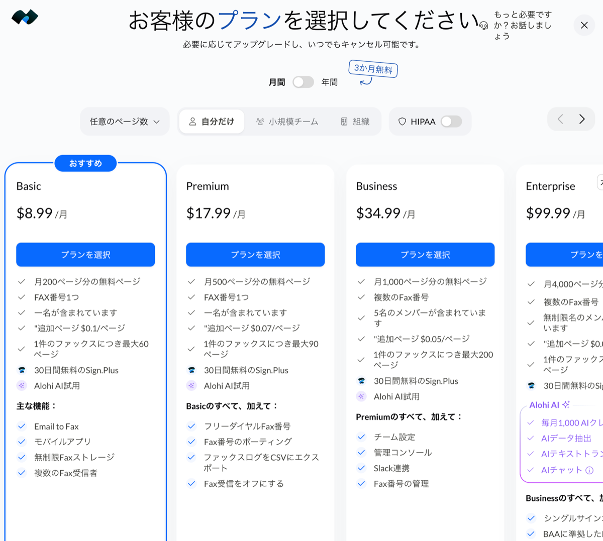
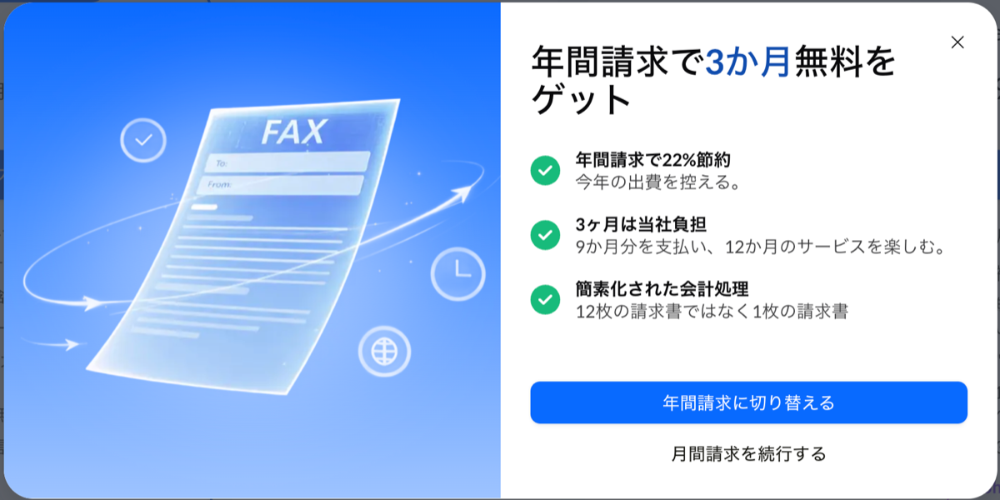

前回の記事に続き、今回はコストを抑えるために自力で行った **IRSへのEIN申請手順** について紹介します。

米国のSSNやITINを持たない非居住者がEINを取得する場合、IRSのオンライン申請が使えないため、**「Form SS-4」に記入してFAX送信**する必要があります。

インターネットFAXサービスの「FAX.PLUS」を利用して日本から申請を行いました。

> - SSN: Social Security Number - 社会保障番号
> - ITIN: Individual Taxpayer Identification Number
> - IRS: 内国歳入庁
> - EIN: Employer Identification Number - 連邦雇用主識別番号

---

## 1. Form SS-4の作成

EINを取得するには、Form SS-4 と呼ばれる申請書を提出する必要があります。
まずはIRSの公式サイトからForm SS-4のPDFをダウンロードします。



- [IRS - Form SS-4 (Application for Employer Identification Number)](https://www.irs.gov/forms-pubs/about-form-ss-4)
  - 右上の検索エリアに `Form SS-4` を入れて検索



- `Form SS-4` ... 申請書
- `Instruction for Form SS-4` ... 申請書の記入要領

PDFの各項目に記入していきます。PDFは直接編集ができます。

- **Line 1**: 設立したLLCの完全な名前
  - `KANTO WORK LLC`
- **Line 2**: 空欄
- **Line 3**: 空欄
- **Line 4a-4b**: Northwestで提供されたエージェント住所
  - `1209 MOUNTAIN ROAD PL, PMB N`
  - `ALBUQUERQUE, NM 87110`
- **Line 5a-5b**: 日本の住所
  - `#000, 1-1-1, SAMPLE-MACHI, SAMPLE-KU`
  - `SAMPLECITY, TOKYO 000-0000 JAPAN`
- **Line 6**: エージェント住所の州と郡 ("County エージェント住所の市名"をWeb検索)
  - `BERNALILLO COUNTRY, NEW MEXICO`
- **Line 7a**: 氏名を名姓の順で
- **Line 7b**: `foreign`
- **Line 8a-8c**: LLCに関する情報
  - `Yes`
  - `1`
  - `Yes`
- **Line 9a**: Type of Entity
  - `Other`
  - (specify) `disregarded entity`
- **Line 9b**: 空欄
- **Line 10**: 申請理由
  - `Start new business`
  - (specify type) `Digital service` `Software development` `e-commerce` など
- **Line 11**: 組織定款に記載の設立日
  - `mm/dd/yyyy`
- **Line 12**: 決算締め月
  - `DECEMBER`
- **Line 13**: 空欄
- **Line 14**: 空欄
- **Line 15**: `N/A`
- **Line 16**: 主要な事業活動
  - `Other`
  - (specify) `Digital service` `Software development` `e-commerce` など
- **Line 17**: 取り扱い品目
  - `Digital products`
- **Line 18**: EIN の有無
  - `No`
- **Third Party Designee**: 空欄
- **Name and title**: `<名前>, MEMBER`
- **Applicant's telephone number**: 電話番号
  - `+81 000 0000 0000`
- **Signature / Date**: 署名と日付
  - 直接編集できないので、PDF編集できるアプリで署名挿入
  - `09/25/2026`
- **Applicant's fax number**: FAX番号
  - `+1 000 000 0000` → 取得したFAX番号を記入

> - LLCの名前や住所などはARTICLES OF ORGANIZATION と完全に一致させる
> - `Instruction for Form SS-4` には Line ごとに詳細の条件などが記載されている。何を書けば良いかわからなかったらこれを見れば解決する。

---

## 2. FAX.PLUS の申し込み

IRSからの返信を受け取るFAX番号が必要となるため、オンラインでFAX送受信ができるサービス **FAX.PLUS** を利用しました。



アカウントを作成し、サインアップを進めます。



IRSからEIN決定通知がFAXで返送されてくるため、**受信用のFAX番号が取得できるBasicプラン**を申し込みます。



FAX番号（米国の番号）を取得・設定します。



短期間の利用で問題がないため、月間請求とします。

---

## 3. IRSへFAXを送信

(1) FAX送信用のカバーシートを作成します

- [カバーシートのテンプレート](https://docs.google.com/document/d/1xHuSbt-8jetE8h5g6jtOm0H0yK43AYagBd2WSX5tbrE)

(2) SS-4 の Applicant's fax number に受信FAX番号を入力し、1ページのみのPDFを作成します

(3) Articles of Organization, Certificate of Organization を結合したPDFを作成します

- **送信先**: [IRSのサイトから最新の国外申請者の送信先を取得](https://www.irs.gov/instructions/iss4#en_US_202512_publink100036476)
  - `outside the United States` の箇所を参照
- **添付ファイル**:
  - (1) カバーシート
  - (2) 作成した `SS-4.pdf` の1ページ目
  - (3) Articles of Organization と Certificate of Organization

送信してステータスが「Delivered（送信完了）」になることを確認します。

---

## 4. 審査待ち

FAX送信が完了したら、あとはIRS側の処理を待ちます。
9/25(金) に送信し、 10/9(金) にFAXで返信がありました。通常、2〜4週間はかかるみたいです。
その後 10/23(金) に、登録エージェントから郵送が届いた旨のメールがありました。スキャンされたPDFに以下が記載されています。

```text
Octover 14 2026
We assigned you an employer identification number (EIN)
Your EIN is 00-0000000. The name control associated with this EIN is ____.
```

---

これで、手元には以下の重要書類が揃った状態になります：

1. **Articles of Organization** と **Certificate of Organization**
2. **Operating Agreement**
3. **EIN** と **name control**

次回は、 **「D-U-N-S Numberの申請手順」** について紹介します。
